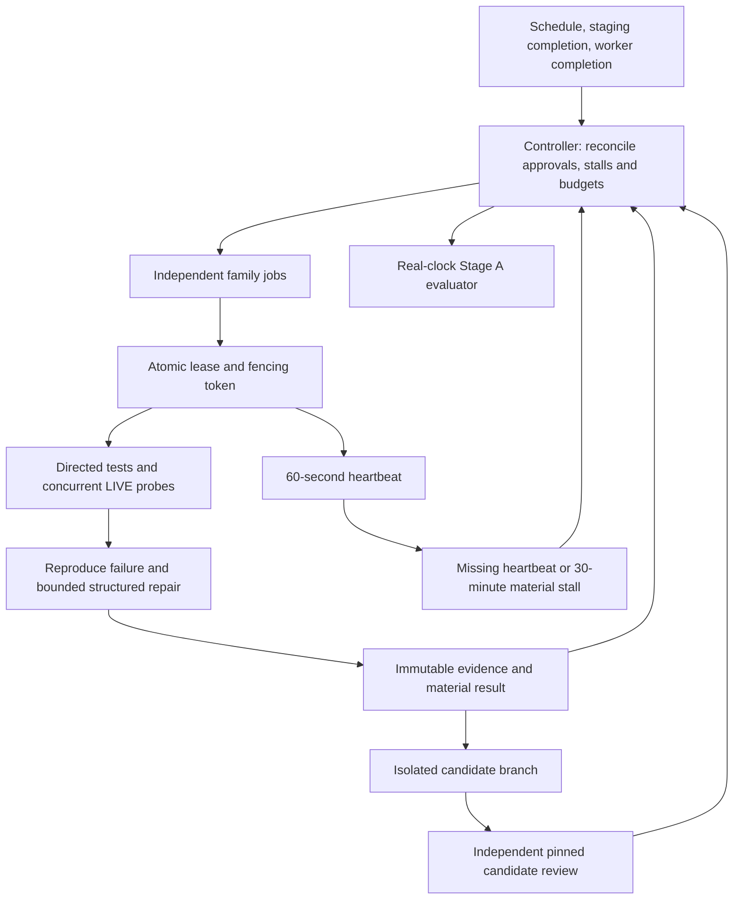

# Alicanto autonomy runtime v2

This runtime changes autonomy infrastructure on main under the owner's explicit
authorization. It never dispatches production deployment, changes production
bytes, or merges product candidates to main or staging. Source/product work is
saved only on isolated `autonomy/<family>/<run>` branches.

The original architect contract, policies, queue, learning ledger and independent
audits were read on staging at `cadb6c2d1f3c286a0dbeea3d236f6f10d47df2bb`.
Those files remain the approval input; they were not copied wholesale into main.
Runtime task status is a durable overlay in `autopilot-state`, not an invented
update to the owner-approved product queue.

Previously, controller and audit jobs refreshed mutable latest JSON while
dispatching only a stale Daily Radar or the same Source Audit. Recovery generated
a fragile unified diff, misclassified the actual assertion and made conflicting
state pushes. A live test could skip while the job stayed green. Global workflow
concurrency and QA failures could stop independent families.

The remaining shared dependencies are GitHub Actions capacity, repository write
authorization and the `autopilot-state` ref. Git is an atomic single authority;
normal fast-forward pushes provide its compare-and-swap boundary. Contention is
replayed over the new head with bounded jitter, not resolved by rebasing JSON or
forcing a ref. If GitHub is unavailable, the worker fails visibly, retains its
artifact where possible, and its lease expires. This is a platform blocker, not
proof that any task completed.

| Trigger | Executor | Durable evidence | Recovery / continuation |
| --- | --- | --- | --- |
| Every ten minutes or completed staging/worker run | Controller | Reconciled `control_v2.json`, immutable observation | Per-family dispatch; no global QA stop |
| Approved media task | Media worker | DF/Pulso commands, URLs, trace hashes | Scoped recovery; another family continues |
| Approved public-data task | Public-data worker | FONASA/ISP/DEIS traces | Independent scoped repair or exact external blocker |
| Approved fiscalization task | Regulatory worker | SIS/SUSESO traces | Independent scoped repair or exact blocker |
| Approved mutualities task | Occupational-health worker | ACHS/Mutual traces | Independent scoped repair or exact blocker |
| Approved editorial parent | Independent editorial repair subtask | Existing reviewed freshness evidence | Preserve parent dependencies and acceptance |
| Demonstrated failed staging run | Staging QA worker | Real run URL, failed log, reproduced gate | Exact constrained edits; never relax the gate |
| Recorded isolated mutation | Separate candidate-review job | SHA-bound full QA/browser/reviewer logs | Retain candidate ref and review blocker; reselect candidate context |
| PASS or evidenced blocker | Controller and next worker | Actual independent transition event | Immediate completion trigger plus scheduled fallback |

Tasks can declare `executor_family` for one of the six supported families.
Unknown approved tasks receive an explicit unsupported-executor blocker and
remain open. Parent/master tasks are not closed by a repaired child. The derived
editorial subtask exists because the owner explicitly requested independent
repair lanes; it does not override the parent task's dependency or closure rules.

Leases last ten minutes, renew every minute and detect missing heartbeat after
three minutes. Token and generation checks run inside the same transaction as
state updates. Thirty minutes without material progress causes `STALLED`, even
with fresh heartbeats. Relevant approval/evidence changes revoke old workers;
an unrelated staging commit does not revoke an active lease. Evidence from a
fenced worker is retained without changing the new owner's task.

An actionable `READY` task with no pickup for thirty minutes also becomes
`STALLED`; waiting for an unmet dependency does not start that clock. Detection
records diagnostic evidence without counting useful progress. The material
clock survives lease generations and rotating audit outputs. At most three
stalled lease recoveries are allowed without material progress. A recovery past
the absolute thirty-minute deadline receives ten minutes that heartbeats cannot
extend; exhausting those recoveries records the lost-lease evidence in a blocker
and leaves other families executable. An unrelated staging commit cannot reopen
that exhausted recovery episode.

Material progress is limited to:

- A durable candidate mutation with executed validation and changed semantic hashes.
- A new blocker with reproducible commands or URLs and stable evidence identity.
- A closure backed by a task/SHA-bound acceptance manifest with hashed evidence.
- An actual pickup of another independent task after a terminal result.

Dispatch, pickup alone, heartbeat, timestamp changes and workflow SUCCESS do not
earn material progress. Repeated audits and failure signatures are capped at
three on unchanged relevant inputs. Blocker order, duplicate aliases, log paths
and observation clocks cannot inflate the metric.

A directed repair may remain durable on an isolated candidate when full QA still
contains an unrelated baseline failure. Its proof must include executed directed
checks, a successful scoped LIVE probe for source repairs, hashed before/after
full-gate logs and no new failure fingerprints. This does not grant closure or
integration. A separate job reviews the exact recorded candidate. Its technical
PASS still cannot replace source 30/90-day reconciliation, publication/rejection
trace, editorial review or the parent's explicit acceptance requirements.

The existing `ai_builder_enabled=false` and no-new-paid-calls policy is respected.
Hosted workers do not enable model repair. Optional future model calls fail
closed unless policy permits them and an approved durable shared budget
reservation exists. The runtime does not invent a reservation, credential,
provider, subscription or budget increase.

Stage A requires four actual consecutive hours, zero owner restart prompts,
autonomous pickup, a durable verified mutation, a verified repair of a real
failure, an independent transition and no material gap over
30 minutes. A simulated clock/test fixture cannot satisfy it. Stage B is 24
hours and Stage C is seven days; neither is claimed by this implementation.
An evidenced blocker remains useful material progress and allows independent
work to continue, but it does not satisfy the Stage A repair requirement. A
partial staging candidate retaining the failed gate cannot claim that failure
repaired. Source recovery must bind the repaired slug to executed directed and
LIVE PASS evidence. Ending with real blockers while independent lanes continue
is a valid operational outcome; it remains `NOT_PROVEN` for Stage A.
Owner involvement targets 30–60 minutes/week: count each manual status/restart
prompt, retain its incident, and automate the missing pickup or recovery path.

## Current evidence and exact continuation

Use `docs/AUTONOMY_CHECKPOINTS.md` and the committed evidence report for directed
test results. The real staging normative test still fails `11 >= 12`; its
contract remains intact. The managed cloud allows package/Git hosts but not the
source destinations, so local DF/Pulso HTTP 403 is a platform-network blocker,
not proof of a defect at the publisher or proof of hosted Actions source access.

After publishing only these infrastructure commits to main, the push event starts
the controller. Inspect `data/autopilot/control_v2.json` on `autopilot-state` and
the unique Actions artifacts; do not use run conclusions as progress evidence.
The scheduler/completion triggers continue independently of this chat.

For a supported task with new repair evidence, update its approved queue evidence
or acceptance manifest. The relevant input fingerprint/evidence revision reopens
the blocked task; a fresh heartbeat or unrelated commit does not. Recorded
candidates retain their branch, exact SHA and review result; candidate context
must be preserved on any retry. A moved candidate ref or changed relevant base
requires an explicit conflict/rebase blocker, not silent fallback to old code.

If publication is blocked, keep every checkpoint commit, the complete patch and
the Git bundle. Review the actual payload and authorize the main infrastructure
push; no product deployment is part of that action. Local tests and local Git
fixtures cannot substitute for hosted pickup, hosted recovery or four wall hours.
