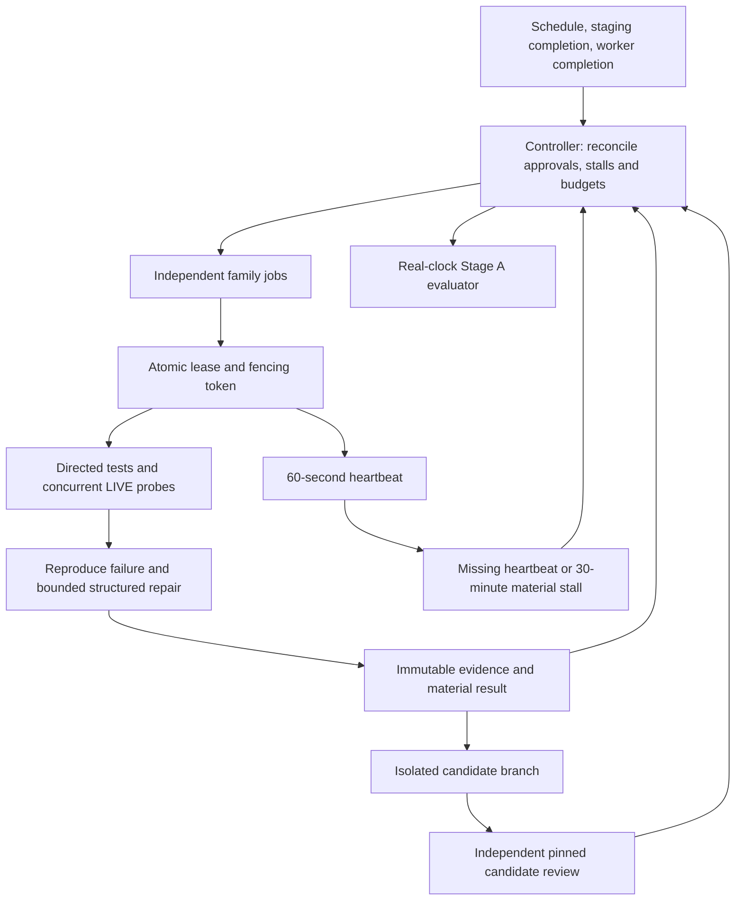

# Alicanto autonomy runtime v2

This runtime changes autonomy infrastructure on main under the owner's explicit
authorization. It never dispatches production deployment, changes production
bytes, or merges product candidates to main or staging. Source/product work is
saved only on isolated `autonomy/<family>/<run>` branches.

The original architect contract, policies, queue, learning ledger and independent
audits were read on staging at `cadb6c2d1f3c286a0dbeea3d236f6f10d47df2bb`.
Those files remain the approval input; they were not copied wholesale into main.
Runtime task status is a durable overlay in `autopilot-state`, not an invented
update to the owner-approved product queue.
The queue was reconciled again at `24d4c1a8d6a70d73324207b33985378aeff36142`,
including the new requirement for verified source runtime after a staging merge.
The latest queue observed before the initial publication was `73aff5c9e97c7c0294ccaf10708f0e6732a90816`;
its later additions are retained as approved backlog, without overriding this
front's prohibition on production promotion.

Previously, controller and audit jobs refreshed mutable latest JSON while
dispatching only a stale Daily Radar or the same Source Audit. Recovery generated
a fragile unified diff, misclassified the actual assertion and made conflicting
state pushes. A live test could skip while the job stayed green. Global workflow
concurrency and QA failures could stop independent families.

The remaining shared dependencies are GitHub Actions capacity, repository write
authorization and the `autopilot-state` ref. Git is an atomic single authority;
normal fast-forward pushes provide its compare-and-swap boundary. Contention is
replayed over the new head with bounded jitter, not resolved by rebasing JSON or
forcing a ref. If GitHub is unavailable, the worker fails visibly, retains its
artifact where possible, and its lease expires. This is a platform blocker, not
proof that any task completed.

| Trigger | Executor | Durable evidence | Recovery / continuation |
| --- | --- | --- | --- |
| Declared ten-minute schedule or completed staging/worker run | Controller | Reconciled `control_v2.json`, immutable observation | Per-family dispatch; no global QA stop |
| Approved media task | Media worker | DF/Pulso commands, URLs, trace hashes | Scoped recovery; another family continues |
| Approved public-data task | Public-data worker | FONASA/ISP/DEIS traces | Independent scoped repair or exact external blocker |
| Approved fiscalization task | Regulatory worker | SIS/SUSESO traces | Independent scoped repair or exact blocker |
| Approved mutualities task | Occupational-health worker | ACHS/Mutual traces | Independent scoped repair or exact blocker |
| Approved editorial parent | Independent editorial repair subtask | Existing reviewed freshness evidence | Preserve parent dependencies and acceptance |
| Demonstrated failed staging run | Staging QA worker | Real run URL, failed log, reproduced gate | Exact constrained edits; never relax the gate |
| Recorded isolated mutation | Separate candidate-review job | SHA-bound full QA/browser/reviewer logs | Retain candidate ref and review blocker; reselect candidate context |
| PASS or evidenced blocker | Controller and next worker | Actual independent transition event | Immediate completion trigger plus scheduled fallback |

Tasks can declare `executor_family` for one of the six supported families.
Unknown approved tasks receive an explicit unsupported-executor blocker and
remain open. Parent/master tasks are not closed by a repaired child. The derived
editorial subtask exists because the owner explicitly requested independent
repair lanes; it does not override the parent task's dependency or closure rules.

Leases last ten minutes, renew every minute and detect missing heartbeat after
three minutes. Token and generation checks run inside the same transaction as
state updates. Thirty minutes without material progress causes `STALLED`, even
with fresh heartbeats. Relevant approval/evidence changes revoke old workers;
an unrelated staging commit does not revoke an active lease. Evidence from a
fenced worker is retained without changing the new owner's task.

An actionable `READY` task with no pickup for thirty minutes also becomes
`STALLED`; waiting for an unmet dependency does not start that clock. Detection
records diagnostic evidence without counting useful progress. The material
clock survives lease generations and rotating audit outputs. At most three
stalled lease recoveries are allowed without material progress. A recovery past
the absolute thirty-minute deadline receives ten minutes that heartbeats cannot
extend; exhausting those recoveries records the lost-lease evidence in a blocker
and leaves other families executable. An unrelated staging commit cannot reopen
that exhausted recovery episode.

Material progress is limited to:

- A durable candidate mutation with executed validation and changed semantic hashes.
- A new blocker with reproducible commands or URLs and stable evidence identity.
- A closure backed by a task/SHA-bound acceptance manifest with hashed evidence.
- An actual pickup of another independent task after a terminal result.

Dispatch, pickup alone, heartbeat, timestamp changes and workflow SUCCESS do not
earn material progress. Repeated audits and failure signatures are capped at
three on unchanged relevant inputs. Blocker order, duplicate aliases, log paths
and observation clocks cannot inflate the metric.
Scoped blocked tasks ignore unrelated staging heads. New approved repair plans,
acceptance references and actual source/QA inputs can reopen them even if a
declared revision token stays fixed. Fingerprints read committed blobs and use
JSON content semantics, so regenerated clocks do not license identical retries.

A directed repair may remain durable on an isolated candidate when full QA still
contains an unrelated baseline failure. Its proof must include executed directed
checks, a successful scoped LIVE probe for source repairs, hashed before/after
full-gate logs and no new failure fingerprints. This does not grant closure or
integration. A separate job reviews the exact recorded candidate. Its technical
PASS still cannot replace source 30/90-day reconciliation, publication/rejection
trace, editorial review or the parent's explicit acceptance requirements.
Source closure requires an incorporated staging SHA and hashed actual runtime
after integration, covering every source with publication, rejection or genuine
absence. A source fix on an isolated branch earns candidate mutation credit;
it cannot earn source implementation or Stage A source-repair credit. A later
authorized merge is recognized by actual Git ancestry and resumes on current
staging without promoting any ref from this runtime.

The existing `ai_builder_enabled=false` and no-new-paid-calls policy is respected.
Hosted workers do not enable model repair. Optional future model calls fail
closed unless policy permits them and an approved durable shared budget
reservation exists. The runtime does not invent a reservation, credential,
provider, subscription or budget increase.

Declared cron is not a measured delivery guarantee. The schedule-only Actions
snapshot in the final hosted evidence records source audit `38116700081` at
06:01:29Z, but its latest scheduled controller is the older `38102304371` at
01:34:45Z. No scheduled new controller is recorded in that snapshot after initial
publication. Main is the actual default branch; push and completion dispatch are
observed. Scheduler delivery cause is undetermined. Do not claim ten-minute
hosted cadence or complete four-hour coverage from the workflow declaration.

Stage A requires four actual consecutive hours, zero owner restart prompts,
autonomous pickup, a durable verified mutation, a verified repair of a real
failure, an independent transition and no material gap over
30 minutes. A simulated clock/test fixture cannot satisfy it. Stage B is 24
hours and Stage C is seven days; neither is claimed by this implementation.
An evidenced blocker remains useful material progress and allows independent
work to continue, but it does not satisfy the Stage A repair requirement. A
partial staging candidate retaining the failed gate cannot claim that failure
repaired. Source recovery must bind the repaired slug to executed directed and
LIVE PASS evidence. Ending with real blockers while independent lanes continue
is a valid operational outcome; it remains `NOT_PROVEN` for Stage A.
Zero owner intervention also requires a verified observation covering the entire
window, with immutable hashed evidence for both Actions and owner prompt events.
Empty arrays alone are not proof. GitHub Actions cannot observe Work/chat prompts;
no such event source is connected in this implementation. Until a trusted event
observer supplies that complete coverage, the evaluator keeps Stage A unproven
while repair lanes remain executable. It never invents a zero-prompt attestation.
Owner involvement targets 30–60 minutes/week: count each manual status/restart
prompt, retain its incident, and automate the missing pickup or recovery path.

## Current evidence and exact continuation

The owner expressly authorized the complete initial seventeen infrastructure
commits, workflow activation and subsequent infrastructure repairs. Seven normal
fast-forward main code publications are durable: b6794bf (05:28:53Z), dd2d206,
9244340, ce40f5a (controller created at 07:03:52Z), c4417f1 (07:32:35Z) and
fc03cfb (publication confirmed at 07:52:53.771697Z) and 15416d1
(publication confirmed at 08:04:01.906332Z).
Only this autonomy exception applies; product/staging promotion, gate
weakening, new credentials or paid services remain unauthorized. Main product
bytes and its existing manual deployment workflow are unchanged. This front did
not configure repository branch protection and does not claim that it did.

Actual controllers 38114913138, 38115967398 and 38118016823 activated six families,
with distinct task leases, fenced generations, renewable minute heartbeats and
independent simultaneous execution. The original first durable pickup remains
2026-10-11T05:29:46.231497Z. Genuine transitions are backed by subsequent independent
claims. Completion and scheduled source-audit SUCCESS add no material event when
inputs and evidenced problems remain unchanged. Pinned counts, tasks, evidence
hashes, UTC and actual proof limits are in work/continuity/hosted-evidence.json.

The real transport defect is repaired: the new fiscalization worker parses the
structured SUSESO evidence before bounding display output. The exact same hosted
55,588-byte captured stdout hash now yields structured source diagnostics.
Sixteen directed source tests pass, while original full QA retains 265 PASS,
one FAIL and one SKIP. ai_builder_enabled=false remains unchanged. The initial
executor incorrectly treated a missing supplied plan as a repair prerequisite;
the approved tasks already permit bounded reversible work. That capability
limitation is corrected by the deterministic planner described below. The SUSESO budget of 24 requests cannot
establish full coverage of its 370-entry inventory. This is infrastructure
transport recovery; no verified source repair or closure is claimed.

Real old recovery 38113859321 failed at a corrupt unified diff and an autopilot
Git-ref race; earlier corrupt lines also repeated. The existing recovery workflow
now dispatches the staging_qa family instead of executing that patch/state writer.
The old writer is replaced, so it cannot run alongside the family mechanism via
that workflow. A new real preview failure 38116961282 still reproduced assert
11 >= 12. Recovery 38116996270 dispatched worker 38117002323, which claimed,
renewed its lease and recorded the actual QA/Reviewer/browser/acceptance blocker.
A competing worker returned NO_EXECUTABLE_TASK without claiming. Product and
editorial gates were not changed, and wrapper SUCCESS is not repair evidence.
See work/continuity/recovery-before-after.json for pinned before/after jobs.

A second real infrastructure defect credited this unchanged QA blocker again
because run IDs, metadata SHA and raw capture hashes rotated. The five isolated
metric commits culminating in 9244340 separate demonstrated problem identity
from bound capture aliases, retain concrete browser failures and asserted dates,
and append a hash-bound correction without deleting raw history. The observer
and evaluator use effective_material_events, which verifies corrections. The
first hosted plan at 06:25:47.641878Z automatically retained raw49/effective48,
retired only f6682fbf… and retained 3ad0c44e…, preserving the real prior transition
and acceptance clock. Later independent events are counted separately; the
continuity snapshot is pinned and does not pretend to freeze current authority.

The isolated lease-heartbeat-v1 canary has actual hosted PASS: 183.402066 seconds
elapsed before STALLED, a new generation was claimed and the old token rejected.
All six checks and immutable proof hashes verified. Its separate control has no
material events or transitions. Fault injection earns no useful-progress,
source-LIVE or four-hour acceptance credit; later verification writes no duplicate.
See work/continuity/canary-proof.json.

The observer independently publishes queue/PMO projections and deduplicated
learning incidents on autopilot-state using fresh CAS. Concurrent writes preserve
existing control history and immutable evidence; no snapshot force push is used.
Observer failure cannot suppress the repair matrix. Governed staging metadata
c4819844 preserves existing Work 3 data and updates only authorized autonomy queue,
PMO and learning evidence; seven targeted PMO tests PASS. The later metric lesson
and observation receipt are append-only on autopilot-state to avoid waking the
same failed preview merely to publish another observation. Such metadata is not
material progress. See work/continuity/learning-ledger-receipt.json.

The next actual source episodes exposed four additional false credits: changing
capture hashes, probe ordering, clocks and diagnostic producer shape had been
mistaken for new source failures. Eleven isolated infrastructure commits ending
at ce40f5a fix structured problem identity, exact guard classification, verified
legacy product bindings and deterministic repair capability. Eight historical
bindings were imported by verifying immutable worker results, actual finish
commit/parent and input product blobs. The importer changed only binding metadata
and one proof; it did not rewrite raw history or task/watchdog state. Offline
replay retains all 58 raw events, projects 53 after five hash-bound corrections,
and preserves eleven transitions and genuinely new fourteen-case QA evidence.
The pinned hosted application is recorded in hosted-evidence.json.
The first actual new plan at 07:04:08.198661Z, committed as c58db62d, verified
that exact 58-to-53 projection before new claims. All eight bindings and raw
events were unchanged. Six no-material-progress STALLED detections earned no
credit. These are pinned reducer counts, not certification that every remaining
historical event satisfies the four-hour useful-work contract.

Probe budget exhaustion is now INCOMPLETE/UNVERIFIED coverage. It is our internal
24-request guard, not a verified publisher/parser failure or source repair. An
independent HTTP, Unicode or parser error still retains its own identity and
evidence; an arbitrary error merely mentioning the guard does not disappear.
Unknown or malformed structured evidence fails closed. Genuine URLs, statuses,
publication/assertion dates, source inventories and content changes remain
material distinctions; clocks and byte-capture aliases do not create novelty.

The read-only deterministic planner recognizes the evidenced ACHS non-ASCII URI
failure, checks the approved task, exact candidate SHA and source/preimage scope,
and produces a bounded replacement without a paid model or supplied repair_patch.
Existing recovery performs isolated application and all unchanged directed,
source LIVE, full QA and Reviewer gates. Failure still rolls back. Unknown cases
produce executor_capability_missing; this is our implementation limitation, not
a demand for new Toba permission. Missing acceptance_artifact prevents verified
closure, not the start of already approved reversible work. A generated plan
alone is not mutation or repair evidence; actual hosted outcome is pinned in the
continuity proof.
Actual mutual-source finish 1522674e at 07:06:00.551910Z records both ACHS
strategy attempts. URI requests passed inside the candidate, but LIVE still
reported zero dated/verified detail items; both attempts rolled back with
changed_paths=[], validated=false and material_progress=false. The unsupported
mutual_seguridad strategy remains a capability blocker. This establishes a real
bounded attempt and honest gate handling, not a durable source repair or closure.

The fourth episode exposed two further invalid credits caused only by a typed
UNSUPPORTED capability diagnostic. Commits 4731574 and c4417f1 normalize that
exact no-plan/no-execution envelope, preserving unknown fields, actual plans,
paid attempts, rejection, baseline evidence and independent errors. Real pinned
replay keeps raw62, projects effective55 with seven corrections and retains all
twelve transitions, fourteen QA/browser cases and actual ACHS attempts. Source
diagnostic output is redundant only when its exact serializer, hashes, byte count
and displayed suffix bind to the recorded JSON. Assertions and non-record text
remain meaningful. Four appearances of the same SUSESO capture retain one actual
capture identity. Canonical engine identity owns material credit; an opaque
producer fingerprint cannot suppress a genuinely new evidenced error.

The fifth actual first plan `a703892e` at 07:32:52.798673Z applied the exact two
additional corrections, preserving raw62, eight bindings, 25 pickups and twelve
transitions. Effective55/seven corrections are verified hosted reducer counts,
not blanket certification of every historical event. Observer `a7495354` changed
only four metadata paths and retained the same control blob. Repair and candidate
jobs were SKIPPED with unchanged inputs; no new claims or material events occurred.
Independent verification checked all eight immutable raw references against both
SHA256 and Git blob hashes. The observed window ended at 07:33:14.686220Z with
7,408.454723 actual seconds and a 2,216.775938-second maximum material gap; the
four-hour and thirty-minute-gap gates remained unmet.

Commit cc0b715 fixes another reproduced store defect: successful Git porcelain
`=` means an identical candidate is already published, so changed=false. A real
competing candidate still triggers fresh reducer replay. Tests use distinct run
identities to force that conflict, retaining the exact retry assertion; a separate
fixed-date real-Git test verifies identical convergence and one immutable episode.
Unknown, missing or duplicate target-ref success status fails closed. No force
push or state-history rewrite is introduced.

Current acceptance remains NOT_PROVEN. No four useful hours, verified product
candidate mutation, source closure or complete owner-event observation is established.
Real source/QA failures, incomplete diagnostic coverage and unsupported repair
strategies remain distinct blockers. The editorial parent waits for an open
dependency rather than being falsely executable. A trusted Work/chat
owner_prompt_events channel is unavailable, so followup count is unknown. Empty
arrays cannot attest zero intervention. Local publisher HTTP403 is managed-network
allowlist evidence and is not a hosted publisher verdict.

Continue using work/continuity/README.md: approved ACHS mutual-source work can use
the known automatic strategy; other families retain their scoped executors.
Unsupported cases require a safe deterministic
strategy or bounded exact replacement from the owning approved front; verified
closure requires real task/SHA-bound hashed acceptance artifacts. Relevant
committed inputs automatically reopen only the affected family;
doc-only commits, unrelated SHAs, heartbeat clocks and repeated audit outputs do not.
Source closure requires actual post-authorized-staging-integration runtime plus
full 30/90-day, publication/rejection/absence, QA and Reviewer evidence. This runtime
never authorizes that product integration or promotes production itself.

A trusted immutable owner event export with completeness watermark and Actions
coverage must span the same actual four-hour window. Connect a producer that
verifies source and immutable hashes before trusted CAS publication. The observer
explicitly retains NOT_PROVEN while that independent channel is absent; authored
control attestations cannot override it. Do not manufacture verified=true or a
zero-prompt attestation.
The evaluator retains the original first pickup and full history, but selects the
latest actual four-hour window once elapsed time permits. Earlier work cannot
satisfy requirements inside a later window; earlier stalls remain visible. The
unchanged material-gap, mutation, real source-repair and observation gates apply
within the selected window. Future clocks and simulations cannot validate it.
Observe real useful work, record all UTC claims, heartbeats, mutations/evidence,
stalls, recovery and transitions, and retain NOT_PROVEN until every acceptance
requirement holds. Correct escalation is demonstrated operational behavior; it
does not satisfy the unchanged legacy Stage A verified mutation/source-repair gates.

Final review reproduced a separate legacy omission: incomplete coverage removed
the whole automated_recovery component, including an extra independent assertion.
Commit fc03cfb recognizes only the exact proven unexecuted guard envelope.
Source output remains hash-bound; known legacy baseline/context digests have
documented actual provenance. New assertions, changed baseline/context, extra
gates, unknown fields and actual repair execution remain meaningful. Six new
test methods and 24 actual negatives pass; the fifth-state projection stays
raw62/effective55/seven corrections with unchanged pickups and transitions.
Independent review then found a self-binding case: fresh nested recovery facts
could match their own row while principal evidence stayed unchanged. Commit
15416d1 corroborates redundancy only with direct independent primary rows;
recovery/context/wrapper rows cannot authorize their own omission. All 29 fresh
hash/boundary negatives preserve changed evidence, while the four proven legacy
adapters and seven historical corrections remain valid and idempotent.

All critical changes are isolated commits. Current complete validation at
`720af52a7e652adcd34afabb43dd609d154f5ca2` is 361 autonomy tests PASS in 30.734
seconds and actionlint 1.7.7 PASS on five workflows. Independent scope review
verified all 54 infrastructure commits and 32 paths without credential findings
or product/gate/deployment changes. Initial 193 and intermediate
244/259/316/330/336/338 results remain archived in the verification JSON. The
351-test candidate PASS and its independent publication hold remain historical.
The original 17-commit bundle and 35/46/49/50/51/54-commit code bundles were verified and restored
from the original main base with identical complete trees. Sanitized published
continuity hashes are in work/continuity/artifact-manifest.json. A final private
bundle also preserves this documentation checkpoint. Any new infrastructure fault
must be reproduced, repaired, tested, committed, published and verified hosted;
leaving a reparable defect as a report alone is insufficient.

The first governance reconciliation snapshot `e87e844a` reconciled only four staging metadata
paths. Independent verification preserved Work3, 82 other queue tasks, original
gates, all product bytes and earlier immutable acceptance evidence. Its resulting
preview `38123952091` still failed `assert 11 >= 12` (one failed, 265 passed,
one skipped). The new recovery dispatched a bounded QA retry, which completed
BLOCKED and released the lease. SUCCESS in its wrapper and controller proves
orchestration, not repair. The actual identical-failure budget moved one to two
of three with no reset and no new blocker credit.

That observation exposed another metric defect: claim credited a different run
ID of already attempted logical QA work as an independent task transition.
The exact event was reproduced against the pinned previous state. It did not
establish useful progress. Its later correction preserves raw history, as
verified below.
The pinned seventh episode remains a valid earlier observation; later counts
and their correction are separate evidence, not edits to that immutable episode.

Trusted metadata binding `0c29dcfb` and published code `720af52` now close that
metric defect. Actual controller `38127573265` first plan `6ba8a53b` retained all
63 raw events and 26 pickups, changed effective56 to55 and corrections7 to8,
and restored twelve effective transitions. Earlier corrections, eight product
bindings, leases, failure history and the first-pickup window remain exact.
Observer `0e1cd350` retained the identical control blob. All fifteen immutable
SHA256/Git-blob references verified; there was no new claim or source retry.
The eight historical corrections are scoped proven duplicates, not a blanket
certification that all 55 effective historical events satisfy this acceptance.

The final-v2 governance CAS `4ff51cfe` used fresh staging parent `eb7e0463`, so
concurrent unrelated changes survive. It modifies only queue/PMO/ledger and the
new immutable acceptance record. Earlier original and final-v1 records remain
byte-exact; the ledger's 21 existing entries remain an exact prefix of 22.
The two owned queue tasks retain statuses, approvals, dependencies and protected
instructions; 82 other tasks, Work3, product, gates and PMO references remain
unchanged. Private schema preflight failures blocked publication until strict
actual-proof aliases passed 19 reconciliation, eight publisher and seven exact
PMO tests plus independent review. Metadata publication counts as zero material
runtime progress and never promotes product.

The eighth hosted observation has a 7,641-second maximum material gap, already
above the unchanged thirty-minute limit. Four elapsed wall-clock hours therefore
do not prove four useful hours. A complete schedule-only Actions snapshot at
09:15:32Z observes no scheduled new controller after first publication; push and
completion pickup work, while the scheduler delivery cause is UNDETERMINED.
No available tool supplies complete trusted owner-event coverage; owner count
remains NULL. Acceptance remains NOT_PROVEN. The final real post-governance
failure and bounded recovery result are recorded separately in hosted-evidence;
historical seventh and eighth observations stay immutable.
